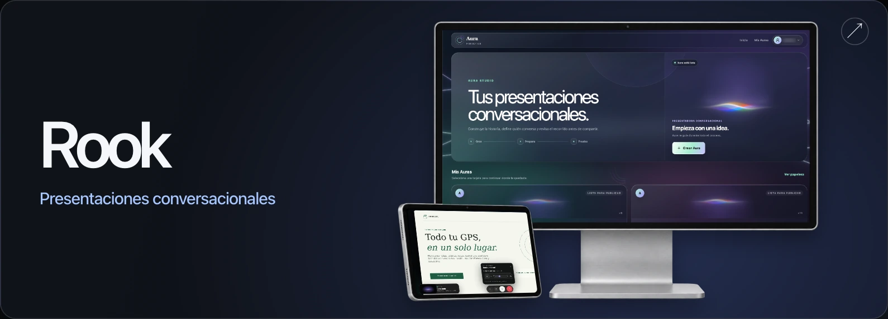

# Rook

Presentaciones interactivas y reuniones con voz en vivo.

<a href="https://clyra.dev/portfolio/rook">
  <picture>
    <source media="(max-width: 650px)" srcset="./media/movil.webp">
    
  </picture>
</a>

En Aura Studio preparas el contenido y revisas el recorrido antes de compartir la presentación. Durante la sesión, los participantes pueden conversar por voz y consultar herramientas autorizadas de AgentOS.

[**Explora el proyecto**](https://clyra.dev/portfolio/rook)　·　[Galería de pantallas](https://clyra.dev/portfolio/rook#project-gallery)　·　[Estudio Clyra](https://clyra.dev/)
